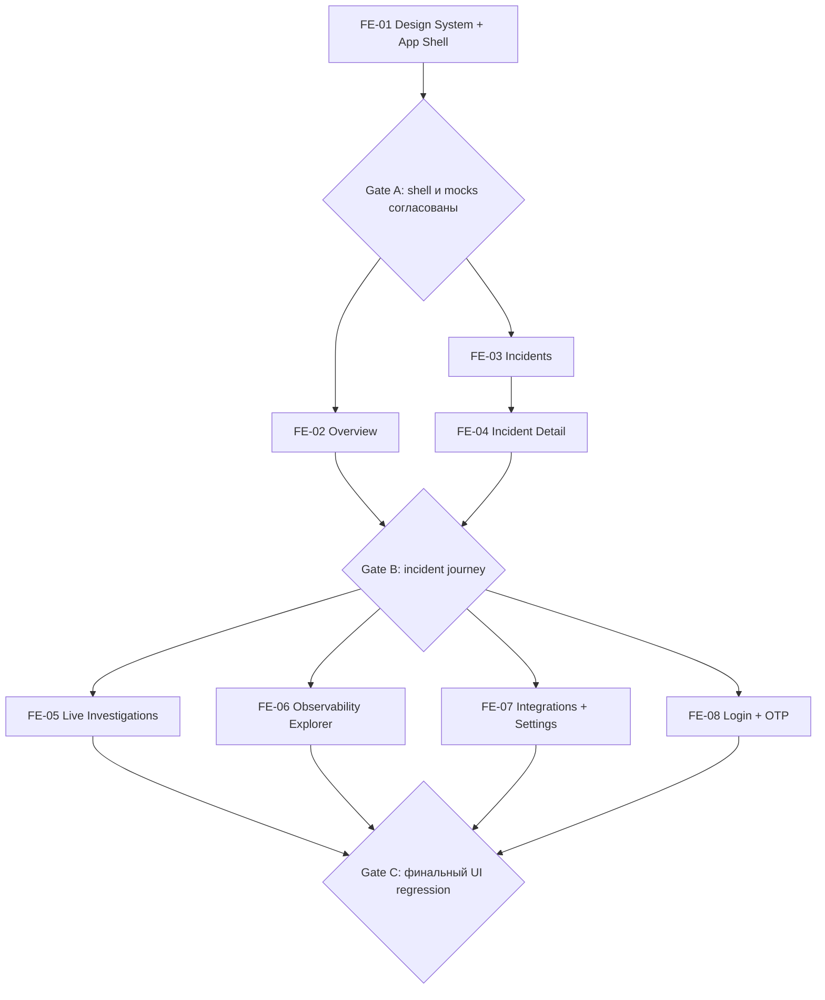

# AI Incident Investigator — Frontend: реестр задач и порядок выполнения

> **Для разработчика Frontend и Claude Code.** Этот каталог — исполнимый план вёрстки и сборки интерфейса на mock-данных. Не является утверждением, что Backend/API уже работают.

## 1. Назначение

**AI Incident Investigator** — инженерная платформа расследования сбоев в микросервисах. Пользователь видит инциденты, состояние сервисов, ход AI-расследования, вызовы диагностических инструментов, гипотезы с подтверждающими Evidence и итоговый RCA Report. Frontend разговаривает с **Main Backend**, а не напрямую с LangGraph, MCP или llama.cpp.

Наш репозиторий: https://github.com/AI-Incident-Investigation-Platform/frontend  
Figma, основной вариант **B / Product screens**: https://www.figma.com/design/JFUcynM2y9vIq6vJ7efTOc?node-id=6-2

**Текущий этап:** качественная вёрстка и локально работающие пользовательские сценарии **без настоящего Backend**. Отделяйте моковые данные и адаптеры так, чтобы позже подключить API и WebSocket с минимальными изменениями UI. Не добавляйте поддельные интеграции, JWT или «реально запущенного AI-агента».

## 2. Источники истины и разрешение конфликтов

1. **Фактически существующий репозиторий**: не ломать работающий код и установленные соглашения.
2. **Макеты Figma B** и согласованные design tokens: композиция, визуальный язык, UI-компоненты.
3. **Актуальные проектные и API-контракты v0.2**, если переданы фронтендеру: названия сущностей, статусы, маршруты и правила доступа. Они остаются draft, пока команда не утвердит их.
4. **Данный план**: последовательность и границы задач. Если задача расходится с контрактом, оформить расхождение, а не выдумывать новое API.

Девять продуктовых экранов уже спроектированы: Overview, Incidents, Live Investigations, Service Map, Logs & Metrics, Traces, Integrations, Settings, Incident Detail. Login/Email OTP — дополнительный поток, визуально согласованный с тем же design system, но **не является одним из девяти готовых макетов**.

**Статус User Audit Log:** отдельный экран и полноценный API ещё не утверждены. Не добавлять его как десятую продуктовую страницу по собственной инициативе. В FE-07 можно обозначить место будущих настроек, но не обещать работающий аудит.

## 3. Рекомендуемый стек (не переписывать существующий без необходимости)

Если репозиторий пуст: **React + TypeScript + Vite**, маршрутизация **React Router**, стили через **CSS variables / modular CSS** или выбранную в проекте эквивалентную систему; **Vitest + Testing Library** для сценариев, **ESLint** и проверка TypeScript. Небольшой набор пиктограмм — Lucide или аналог без массивного UI framework. Не добавлять состояние глобального уровня, таблицы, графовую библиотеку и query-кеш просто «на будущее»: зависимость должна закрывать задачу.

Рекомендуемые логические зоны (имена корректировать с учётом кода): `app/` (router/shell), `shared/ui/` (общие компоненты), `shared/styles/` (tokens), `entities/` (типы и модели), `features/` (фильтрация и UI-операции), `pages/`, `mocks/`, `services/` (будущие API-adapters), `tests/`. Не плодить пустые каталоги и файлы ради схемы.

## 4. Реестр задач, зависимости и конечный результат

| ID | Задача | После чего | Результат, который можно показать | Макет |
|---|---|---|---|---|
| [FE-01](./FE-01_DESIGN_SYSTEM_AND_APP_SHELL.md) | Frontend foundation, дизайн-система, App Shell | Инициализация репо | Запускаемое приложение, sidebar, маршруты, токены, UI primitives, проверка build | [Figma B](https://www.figma.com/design/JFUcynM2y9vIq6vJ7efTOc?node-id=6-2) |
| [FE-02](./FE-02_OVERVIEW_DASHBOARD.md) | Overview | FE-01 | 4 KPI, Recent Incidents, Services Requiring Attention, кликабельные переходы | [6:24](https://www.figma.com/design/JFUcynM2y9vIq6vJ7efTOc?node-id=6-24) |
| [FE-03](./FE-03_INCIDENTS_REGISTRY.md) | Incidents | FE-01 + общие mocks | Поиск, комбинируемые фильтры, сортировка и переход по incident ID | [6:26](https://www.figma.com/design/JFUcynM2y9vIq6vJ7efTOc?node-id=6-26) |
| [FE-04](./FE-04_INCIDENT_DETAIL.md) | Incident Detail | FE-03 + FE-01 | 6 вкладок: Overview, Live Investigation, Hypotheses, Evidence, Timeline, RCA | [6:40](https://www.figma.com/design/JFUcynM2y9vIq6vJ7efTOc?node-id=6-40) |
| [FE-05](./FE-05_LIVE_INVESTIGATIONS.md) | Live Investigations | FE-01 + shared incidents/runs | Список run, прогресс шагов, tool activity и разные состояния | [6:28](https://www.figma.com/design/JFUcynM2y9vIq6vJ7efTOc?node-id=6-28) |
| [FE-06](./FE-06_OBSERVABILITY_EXPLORER.md) | Service Map, Logs & Metrics, Traces | FE-01 + shared mocks | Топология, фильтруемые логи, метрики, trace waterfall | [6:30](https://www.figma.com/design/JFUcynM2y9vIq6vJ7efTOc?node-id=6-30) / [6:32](https://www.figma.com/design/JFUcynM2y9vIq6vJ7efTOc?node-id=6-32) / [6:34](https://www.figma.com/design/JFUcynM2y9vIq6vJ7efTOc?node-id=6-34) |
| [FE-07](./FE-07_INTEGRATIONS_AND_SETTINGS.md) | Integrations, Settings | FE-01 | Настройки источников, роли, параметры исполнения; локальные формы | [6:36](https://www.figma.com/design/JFUcynM2y9vIq6vJ7efTOc?node-id=6-36) / [6:38](https://www.figma.com/design/JFUcynM2y9vIq6vJ7efTOc?node-id=6-38) |
| [FE-08](./FE-08_LOGIN_AND_EMAIL_OTP.md) | Login + Email OTP | FE-01 | Два экрана входа, работающая mock-валидация и переход в Overview | Новый экран, опираемся на B |

**Принципиальная последовательность первого демо:** **FE-01 → FE-02 → FE-03 → FE-04**, затем **FE-05 → FE-06 → FE-07 → FE-08**. FE-05/06/07/08 могут выполняться параллельно после объединения FE-01, если у команды достаточно исполнителей, но совместная модель данных/компоненты не должны расходиться. FE-06 допускает внутреннее дробление на 6A/6B/6C.

## 5. Схема выполнения и контрольные барьеры



- **Gate A / после FE-01:** общий layout, typography, tokens, навигация, компоненты, mock types готовы; нет существенных визуальных расхождений; нет конфликтующих CSS-систем.
- **Gate B / после FE-02–FE-04:** путь Overview → Incidents → Incident Detail существует; один инцидент имеет одинаковый ID, сервис, severity и статус везде; 6 вкладок открываются без ошибок.
- **Gate C / после FE-05–FE-08:** все продуктовые экраны и Login/OTP доступны; mocks не выдают себя за реальный Backend; ручная и автоматическая регрессия пройдены, интерфейс сравнен с Figma.

Дополнительная линейная/параллельная схема: [EXECUTION_SCHEME.md](./EXECUTION_SCHEME.md).

## 6. Как выполнять КАЖДУЮ задачу с Claude Code

**Одна задача → отдельная ветка → одна предметная сессия Claude → тесты → визуальное ревью → PR.** Не скармливать все FE-01–FE-08 одним запросом. Инструменты BMad не устанавливаются, используем только метод: анализ → выполнение → проверка → ревью.

### Перед началом

1. Подтянуть актуальный `main`, изучить `README`, исходники, `AGENTS.md`/правила репо, если есть, и соответствующий `FE-XX*.md`.
2. Посмотреть **конкретный Figma node** и соседние экраны для сопоставления плотности, размеров, состояний. Если у Claude нет доступа к Figma — предоставить скриншот и спецификацию, не просить «придумать похоже».
3. Сверить существующие компоненты и mock schemas, назвать зависимости задачи и список планируемых файлов.
4. Создать ветку вида `feat/fe-02-overview`. Не переписывать настройки проекта под задачу.

### Во время реализации

1. Реализовать только scope конкретного файла задачи, отделяя page component, mock adapter, model, presentation.
2. UI взаимодействия должны работать локально; «кнопки для красоты» не принимаются.
3. Не создавать сетевые запросы, fake tokens и fake WebSocket как якобы настоящую интеграцию.
4. Взять из [DESIGN_QUALITY_GATE.md](./DESIGN_QUALITY_GATE.md) общие *Anti-AI-slop* правила **как обязательные для каждого экрана**; повторные локальные уточнения внутри задачи имеют приоритет для этого экрана.
5. Сразу реализовывать пустые, ошибочные, загружающиеся и длинные состояния там, где они нужны.

### После реализации

1. Запустить команды реального репозитория: lint/typecheck/test/build; не выдумывать результаты.
2. Проверить страницу в браузере минимум на **1440, 1280 и 768 px**, а также узкую ширину (около 390 px) без обязательства сохранить desktop-топологию 1:1.
3. Сравнить side-by-side со скриншотом Figma; устранить смещения, низкий контраст, ошибочную визуальную иерархию, обрезание текста и неверную плотность.
4. Пройти чек-лист задачи и [DESIGN_QUALITY_GATE.md](./DESIGN_QUALITY_GATE.md); приложить скриншоты desktop + narrow/ tablet и результаты команд.
5. Создать PR с описанием изменений, ручного тестового сценария, ограничений и ссылкой на `FE-XX`.

**Шаблон первого сообщения Claude Code для каждой Story:**

```text
Выполни FE-XX из docs/tasks/FE-XX_....md. Сначала прочитай docs/tasks/README.md
и docs/tasks/DESIGN_QUALITY_GATE.md, а также правила репозитория. Проверь актуальные
компоненты, mocks и макет Figma, составь короткий план файлов. Затем реализуй только
эту Story. Mock-only, без Backend. Проверь lint/typecheck/test/build, сравни скриншот
с Figma на 1440/1280/768/390 px и перечисли расхождения. Не объявляй готовность,
пока не выполнишь acceptance criteria. Не делай push/merge без разрешения.
```

## 7. Общие правила интеграции и поведения

- **Контракт данных:** единые `incidentId`, `runId`, `serviceId`; дата/время с явно указанной timezone. Figma-значения — пример, не обещание live telemetry.
- **Одна каноническая mock-fixture**: incident `INC-1042`, `payment-service`, таймауты PostgreSQL/заполненный pool/недавний deployment, связан с журналом run/evidence/trace. Не создавать отдельные несовместимые версии одного инцидента в каждом компоненте.
- **Frontend ↔ Main Backend**: REST для запросов и WebSocket для обновлений при будущем подключении; прямого Frontend ↔ AI Backend не будет.
- **Разграничение прав**: Admin/Developer/Viewer визуально отражаются; настоящие разрешения проверяет Backend. UI-моки не являются безопасностью.
- **Login**: password → challenge → OTP verification → tokens только от Backend. Пока токены не эмулировать как реальные.
- **Tool calls**: показывать действия и краткие summaries, не внутреннее скрытое reasoning модели.
- **RCA**: отделять возможную гипотезу от подтверждённого Evidence и решения человека.
- **Иконки/цвета/графики**: семантическая кодировка; элементы доступности и контраст не жертвуются «красоте».

## 8. Правила работы с Git и границы

- Одно изменение — одна ветка и один PR; при одиночном исполнителе допускаются последовательные ветки.
- Не менять файлы параллельной задачи без договорённости и общего ревью.
- Не менять API v0.2 или продуктовую семантику ради удобства фронта; фиксировать вопросы.
- Не переписывать `AGENTS.md` и другие управляющие файлы без явного поручения; не добавлять BMad Method.
- Не подключать продовые credentials/сервисы, не коммитить `.env` и секреты.
- Откладывать не относящиеся к Story баги в PR notes / следующую Story.
- Перед merge/после merge проверять сборку.

## 9. Условия полной готовности

**Отдельный экран «выглядит красиво» ≠ задача закрыта.** Он должен работать со своими mocks, не разрушать остальные экраны, отвечать acceptance criteria и пройти визуальное ревью.

**Фронтенд этапа mock-first готов**, когда:

1. Все девять продуктовых экранов + Login/OTP доступны с навигацией.
2. Overview → Incidents → Incident Detail → Live Investigation/RCA проходим без Backend.
3. Фильтры, вкладки, форма OTP, выбор сервиса, выбор трассы и демонстрационные UI-действия функциональны.
4. Общие состояния loading/empty/error и основные права пользователей визуально учтены.
5. Демонстрационные данные согласованы и явно не представляются real-time production-фактами.
6. Все экраны выдержаны в **одном стиле Figma B**, без AI-slop и декоративного шума.
7. `lint`, `typecheck`, `test`, `build` реально пройдены, есть скриншоты и понятные инструкции запуска.

**Не входит в текущую готовность:** реальные REST API, WebSocket, авторизация, диагностика Elasticsearch/Prometheus/Tempo, сохранение настроек, исполнение LangGraph и получение настоящего RCA. Это следующий этап после согласования Backend-контрактов.
